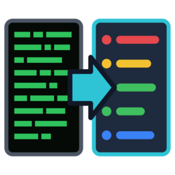
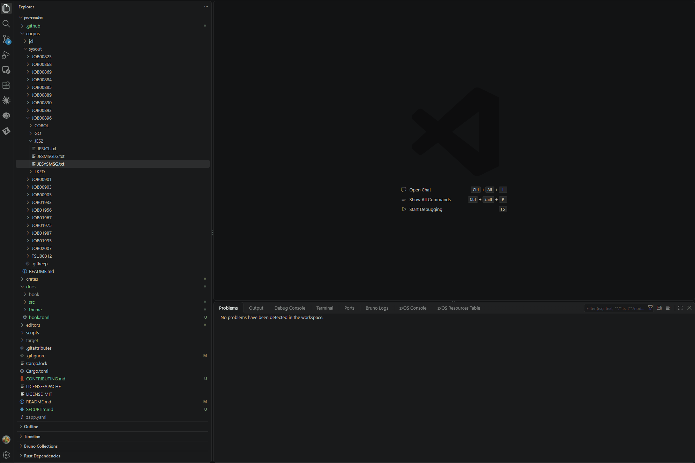

<h1 align="center">
  <br>
  JES Reader
</h1>

<p align="center">
  <strong>Read z/OS JES2 sysouts the way you read code.</strong><br>
  Failures in the Problems panel, job steps in the Outline, a click from a message to its JCL.
</p>

<p align="center">
  <a href="https://marketplace.visualstudio.com/items?itemName=peariforme.jes-reader"></a>
  <a href="https://crates.io/crates/jes-reader-cli"></a>
  <a href="https://github.com/Peariforme/jes-reader/actions/workflows/ci.yml"></a>
  <a href="#license"></a>
</p>

<p align="center">
  <a href="https://peariforme.github.io/jes-reader/">Documentation</a> ·
  <a href="https://peariforme.github.io/jes-reader/getting-started/installation.html">Install</a> ·
  <a href="https://peariforme.github.io/jes-reader/project/changelog.html">Changelog</a>
</p>



A sysout is thousands of lines of fixed-width text, and finding *which step failed and why* means knowing that `IEF472I` is an abend although it ends in `I`. JES Reader does that reading for you, in VS Code, on the spool files you open from [Zowe Explorer](https://marketplace.visualstudio.com/items?itemName=Zowe.vscode-extension-for-zowe), on downloaded jobs, and on whole spools saved by BMC AMI DevX.

Everything runs on your workstation: nothing is installed on z/OS, nothing is sent over the network.

## Features

- **Failures first**: abends (`S0C7`, `S806`, `U4038`…), JCL errors and missing data sets as errors, return codes above a threshold as warnings, each linked to the messages that explain it.
- **The job at a glance**: steps in the Outline with their program and outcome; above each step, its return code, CPU and elapsed time.
- **Navigation**: Ctrl+click from a message or a step to the expanded JCL, from a data set name to the data set in Zowe Explorer.
- **Explanations**: hovers on message IDs and abend codes, in plain words, with the reason code and a link to IBM Docs.
- **House rules**: a small `.jesreader.toml` to silence a message or tolerate a return code, shared with your team.
- **The same analysis in CI**: `jes-reader check` with text, JSON or SARIF output, `jes-reader summary` for a per-step report.

## Install

| | |
| --- | --- |
| **VS Code** | [Visual Studio Marketplace](https://marketplace.visualstudio.com/items?itemName=peariforme.jes-reader), or a VSIX from the [latest release](https://github.com/Peariforme/jes-reader/releases/latest) for an offline workstation (no admin rights needed) |
| **Command line** | `cargo install jes-reader-cli`, or an archive from the [latest release](https://github.com/Peariforme/jes-reader/releases/latest) |
| **Neovim, Helix…** | `cargo install jes-reader-lsp`, see [Other editors](https://peariforme.github.io/jes-reader/guide/other-editors.html) |

Windows x64, Linux x64 and arm64, macOS x64 and arm64. No runtime to install.

## Command line

```console
$ jes-reader summary JOB00896
JRS0C7 JOB00896: ended, abend S0C7
  STEP          PROGRAM         OUTCOME              CPU     ELAPSED
  COBRUN.COBOL  IGYCRCTL        RC 0                 0.04 s  0.00 s
  COBRUN.LKED   IEWBLINK        RC 0                 0.01 s  0.00 s
  COBRUN.GO     *.LKED.SYSLMOD  abend S0C7 reason 7  0.00 s  0.00 s
  error: Step COBRUN.GO: abend S0C7 (Data exception), reason 00000007 (JOB00896/JES2/JESYSMSG.txt:131)
```

See [Command line](https://peariforme.github.io/jes-reader/guide/cli.html) for `check`, the output formats and a CI example.

## Project

| Path | Contents |
| --- | --- |
| [`crates/jes-reader-core`](crates/jes-reader-core) | Parser, analysis, message catalog, house rules |
| [`crates/jes-reader-lsp`](crates/jes-reader-lsp) | Language server |
| [`crates/jes-reader-cli`](crates/jes-reader-cli) | `jes-reader` command line |
| [`editors/vscode`](editors/vscode) | VS Code extension |
| [`corpus`](corpus) | Test JCL and the sysouts they produce on IBM Z Xplore, no customer data |
| [`docs`](docs) | Documentation site |

Status and plans: [Roadmap](https://peariforme.github.io/jes-reader/project/roadmap.html). Contributions are welcome: see [CONTRIBUTING.md](CONTRIBUTING.md). Please never attach a real sysout from your site to an issue.

## License

Licensed under either of [MIT](LICENSE-MIT) or [Apache-2.0](LICENSE-APACHE), at your option.

JES Reader is an independent project, not affiliated with IBM, BMC or the Zowe project.
