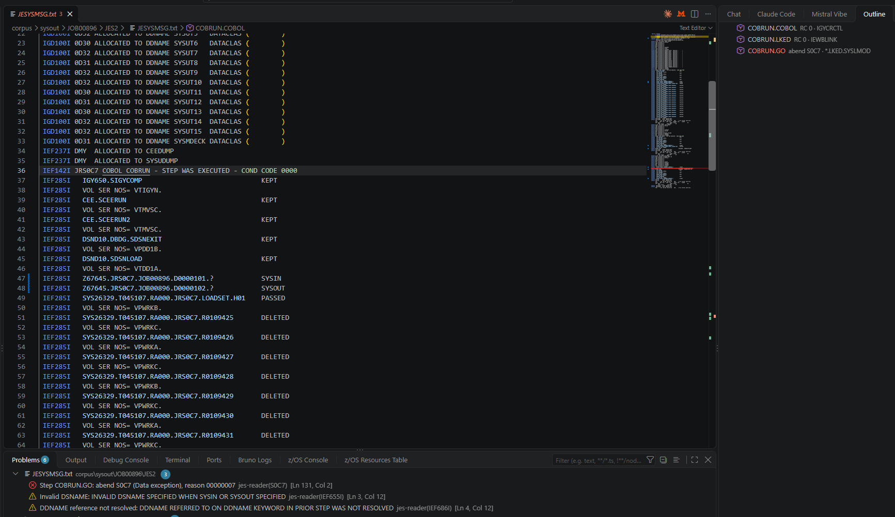

# Your first sysout

## From Zowe Explorer

1. In the **Jobs** view of Zowe Explorer, expand a job.
2. Open `JESYSMSG` (or any other DD).

JES Reader recognizes the document from its name and analyses it at once. Each DD is analysed on its own: you never need to download the whole spool. When it needs the job's `JESJCL` (for step programs and links to the JCL), JES Reader fetches just that DD in the background.

## From a downloaded job

When Zowe Explorer downloads a job, it writes one file per DD:

```text
JOB00896/
  JES2/JESMSGLG.txt
  JES2/JESJCL.txt
  JES2/JESYSMSG.txt
  GO/COBRUN/SYSOUT.txt
```

Open the folder in VS Code and open any of those files. JES Reader reads `JESJCL.txt` next to the file when it needs it.

For other files, see [Recognized files](../guide/recognized-files.md). When a file is not recognized, run **JES Reader: Open as Sysout** from the Command Palette.

## What to look at



- **Problems panel** (Ctrl+Shift+M): what went wrong, errors first. Click a problem to jump to the message. See [Problems panel](../guide/problems.md).
- **Outline** (in the Explorer side bar): one entry per step, with its program and outcome. See [Outline and step summaries](../guide/outline.md).
- **Above each step** of `JESYSMSG`: program, return code or abend, CPU and elapsed time.
- **Hover** a message ID or an abend code for an explanation. **Ctrl+click** a statement number or a step to open its JCL. See [Navigation and hovers](../guide/navigation.md).

## Try it without a mainframe

The repository holds a corpus of real sysouts produced on IBM Z Xplore, with no customer data. Clone it and open `corpus/sysout` in VS Code:

```sh
git clone https://github.com/Peariforme/jes-reader
code jes-reader/corpus/sysout
```

Good starting points: `JOB00896` (S0C7 abend), `JOB00901` (S013 with a Fault Analyzer report), `JOB00868` (IDCAMS return codes), `JOB00889` (JCL error).
