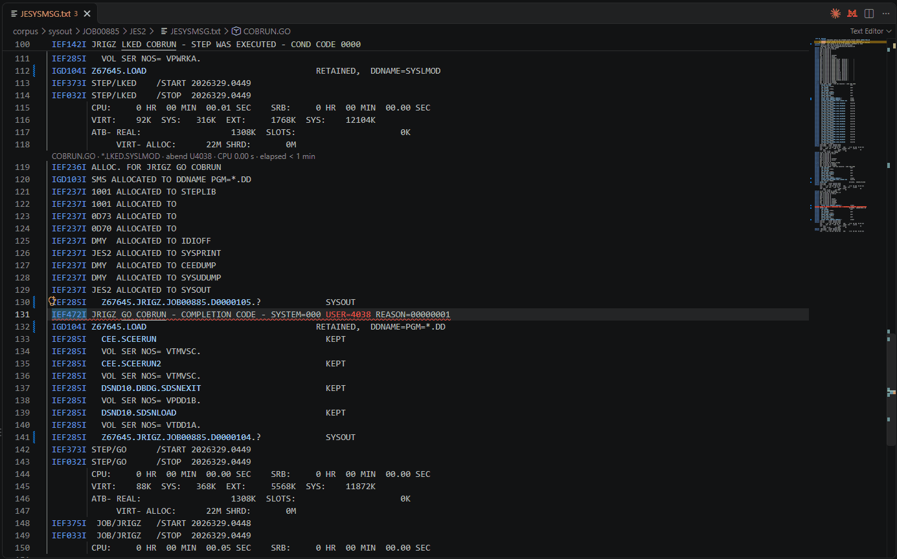
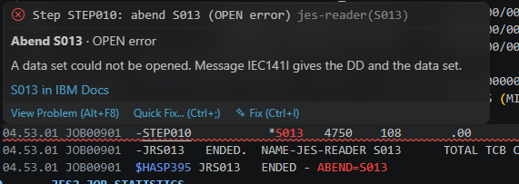

# Navigation and hovers

## From a message to the JCL

Ctrl+click (or F12) in `JESYSMSG` or `JESMSGLG` to open the expanded JCL in `JESJCL`:

- on a **statement number** (`11 IEF655I …`): statement 11 of the JCL;
- on a **step's outcome** (`IEF142I`, `IEF472I`, a row of the step table): the step's `EXEC` statement, inside the procedure for procedure steps.

Link targets are underlined. Hover one to see the JCL statement it leads to without leaving the message.

For documents opened from Zowe Explorer, JES Reader fetches just the `JESJCL` DD in the background. For downloaded jobs, it reads `JESJCL.txt` next to the file.

## Data set links

Ctrl+click a data set name (`SYS1.MACLIB(JRNOMBR)`, `ISP.SISPEXEC`…) to open it, or the member, with Zowe Explorer. A partitioned data set opens in Zowe Explorer's Data Sets view.

Documents opened from Zowe Explorer use the profile of their job. For other documents (BMC AMI DevX, downloaded files), set `jesReader.zoweProfile` to the Zowe Explorer profile of the same system.

Temporary data sets (`&&TEMP`), spool data sets, symbolic names and dump text are not linked.

## Hovers

Hover a message ID or an abend code for:

- a short explanation, in our own words;
- the meaning of the reason code when it is known (`S013-18`: member not found);
- what to check;
- a link to IBM Docs: the message page of the z/OS 3.2 documentation for z/OS messages (`IEF`, `IEC`, `IGD`, `IEA`, `CSV`, `IDC`, `ICH`, `IRR`, `$HASP`, `CEE`), and a search for the others.

Abend codes are recognized wherever they appear: `SYSTEM=0C7`, `*S0C7`, `ABEND=U4038`, `ABEND806-04`.

The catalog covers about 70 common messages and 20 abend codes, among them IDCAMS, Language Environment, COBOL, Db2 and IMS messages. Every other message still gets its link to IBM Docs.
