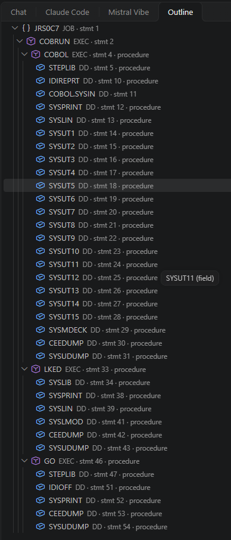
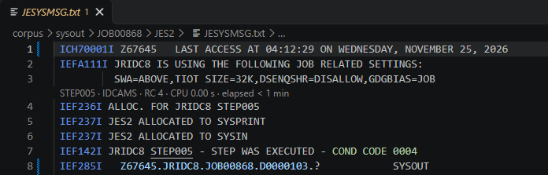

# Outline and step summaries

## Outline

The Outline view (in the Explorer side bar, or Ctrl+Shift+O for a quick list) shows the structure of the open DD.

- In `JESMSGLG` and `JESYSMSG`: every step with its outcome (`RC 0`, `abend S0C7`, `not run`) and its program, procedure steps included (`COBRUN.GO`).
- In `JESJCL`: a `JOB → EXEC → procedure EXEC → DD` tree.
- In a [whole spool](recognized-files.md#whole-spools): one entry per DD, with the steps under `JESYSMSG`.



## Step summaries

Above each step of `JESYSMSG`, a line sums the step up: name, program, return code or abend, CPU time and elapsed time.

```text
STEP010 · IDCAMS · RC 8 · CPU 0.01 s · elapsed < 1 min
```



The program comes from the `PGM=` of the step's `EXEC` statement in `JESJCL`. A step that runs a module link-edited by a previous step shows the reference (`*.LKED.SYSLMOD`).

Elapsed time in `JESYSMSG` is only known to the minute: it shows as `< 1 min` or `~N min`. CPU time is known to the hundredth of a second.

Step summaries are VS Code code lenses: turn them off with the `editor.codeLens` setting.

## Folding

Steps, JCL statements and messages that run over several lines can be folded, like blocks of code.
