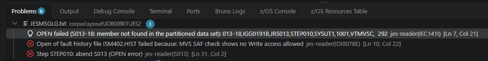

# Problems panel

JES Reader reports what went wrong in the job as diagnostics, in the Problems panel (Ctrl+Shift+M) and as squiggles in the editor.

## What is reported

| Severity | What |
| --- | --- |
| Error | Abends (`S0C7`, `S806`, `U4038`…), JCL errors, data sets not found, modules not found |
| Warning | Steps that ended with a return code above the threshold (4 by default) |
| Information | Steps that did not run |

Change the threshold with the `jesReader.maxReturnCode` setting, or per step or program with [house rules](house-rules.md).

## Severity is not the message suffix

The last letter of a z/OS message ID is a poor guide: `IEF453I` (JCL ERROR) and `IEF472I` (abend) both end in `I`, for "information". JES Reader takes the severity, in this order:

1. from the steps: an abend, a return code above the threshold, a step that did not run;
2. from its catalog of known messages, which knows that `IEF453I` is an error;
3. from the suffix (`E`, `S`, `W`) for the other messages.

[House rules](house-rules.md) come first and can change any of these.

## Cause and effect

A failed step points to the messages that explain it, and each of those messages points back to the step. In the Problems panel, expand a step's abend to see, for example, the `IEC141I 013-18` message that caused an `S013`. Click it to jump there.

## Messages colored by severity

In the editor, message IDs are colored by the severity JES Reader reports, house rules included: a message you silence with a rule is no longer shown in red. Return codes above 4, abend codes, data set names and JCL statements are highlighted too.
