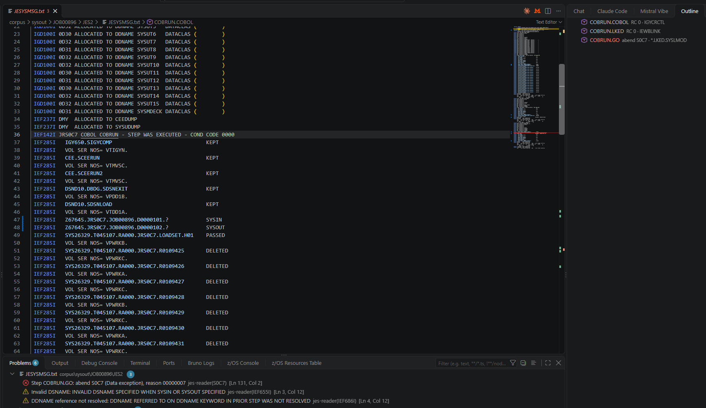

# JES Reader

**Read z/OS JES2 sysouts the way you read code.** JES Reader turns a job's output into a navigable document: failures in the Problems panel, job steps in the Outline, messages colored by severity, and a click from a step to its JCL.

## Why

A sysout is thousands of lines of fixed-width text. Finding out *which step failed and why* means scrolling through `JESMSGLG`, `JESJCL` and `JESYSMSG`, recognizing that `IEF472I` is an abend although it ends in `I`, and looking up `IEC141I 013-18` in IBM Docs. JES Reader does that reading for you, inside the editor you already use.

## What you get

- **Failures first**: abends (`S0C7`, `S806`, `U4038`…), JCL errors, missing data sets and return codes above a threshold, in the Problems panel, each linked to the messages that explain it.
- **The job at a glance**: steps in the Outline with their program and outcome, a summary above each step with its return code, CPU and elapsed time.
- **Navigation**: from a message or a step to the expanded JCL, from a data set name to the data set in Zowe Explorer.
- **Explanations**: hovers on message IDs and abend codes, in plain words, with the meaning of the reason code and a link to IBM Docs.
- **Your site's conventions**: house rules in a small TOML file to silence a message or tolerate a return code.
- **The same analysis in CI**: a command-line checker with text, JSON and SARIF output.

## Where it runs

Everything runs on your workstation. JES Reader installs nothing on z/OS and opens no connection to it: it reads the spool files that [Zowe Explorer](https://marketplace.visualstudio.com/items?itemName=Zowe.vscode-extension-for-zowe) opens, files you have downloaded, and whole spools saved by BMC AMI DevX.

It ships as:

| Component | For | Install |
| --- | --- | --- |
| VS Code extension | Day-to-day reading | [Visual Studio Marketplace](https://marketplace.visualstudio.com/items?itemName=peariforme.jes-reader), or an offline VSIX |
| `jes-reader` CLI | Scripts and CI | `cargo install jes-reader-cli`, or a prebuilt binary |
| `jes-reader-lsp` | Neovim, Helix and other LSP clients | `cargo install jes-reader-lsp` |

Start with [Installation](getting-started/installation.md).

## License

JES Reader is free and open source, under the MIT or Apache-2.0 license, at your option. It is not affiliated with IBM, BMC or the Zowe project.
